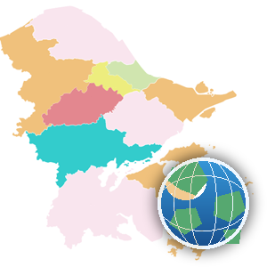

Six more interface languages for [Province](https://github.com/KaibuchiShuuki/Province) — 繁體中文, Français, Русский, Español, 日本語, 한국어 — without touching a line of game code.

给 [Province](https://github.com/KaibuchiShuuki/Province) 补上六种界面语言：繁體中文、Français、Русский、Español、日本語、한국어；游戏代码一行都不用动。

**Install**

1. Put `ProvinceTranslation-0.2.4.0.jar` and `Province-0.2.4+<mc>.jar` in `mods`.
2. Open Province settings → interface language, pick one. Everything else just follows the game.

**安装**

1. 把 `ProvinceTranslation-0.2.4.0.jar` 和对应版本的 `Province-0.2.4+<mc>.jar` 一起放进 `mods`。
2. 打开 Province 设置 → 界面语言，挑一个即可，其余会跟着游戏语言走。

Needs Province 0.2.4 or newer. Without this mod Province shows Simplified Chinese and English only.

需要 Province 0.2.4 或更新版本。不装它时，Province 只有简体中文和英文。

Found a translation mistake? [Open an issue](https://github.com/KaibuchiShuuki/Province-Translation/issues) with the key name — a missing line counts too.

翻译有误？[提个 issue](https://github.com/KaibuchiShuuki/Province-Translation/issues)，带上键名就行，漏翻也算。
